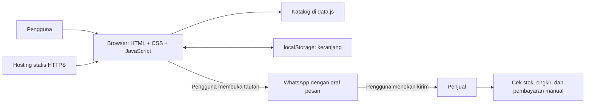
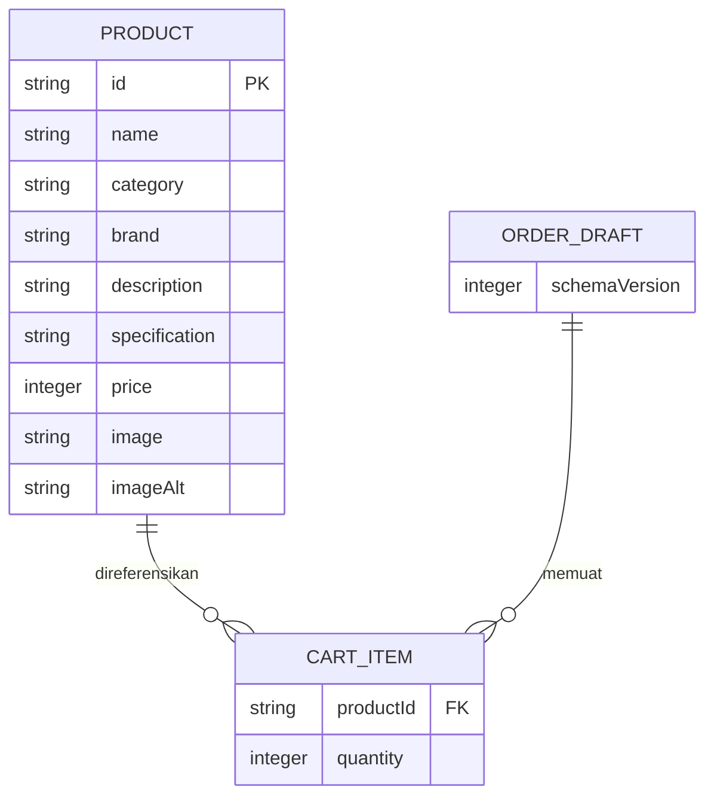

# Arsitektur Sistem — Goresan Store

> Arsitektur = gambaran bagian-bagian website dan cara mereka bekerja sama.

## 1. Bentuk sistem
Aplikasi frontend statis satu halaman, dipecah menjadi beberapa modul JavaScript. Tidak ada backend dan tidak ada database. Server hosting hanya mengirim HTML, CSS, JavaScript, dan gambar. Pencarian dan hitungan berjalan di browser pengguna.



## 2. Struktur berkas
```text
peralatan-gambar/
├── index.html
├── css/styles.css
├── js/
│   ├── config.js       # Nama toko, nomor WhatsApp, alamat, jam buka
│   ├── data.js         # Daftar produk
│   ├── app.js          # Mulai aplikasi, tampilkan katalog, pencarian, filter
│   ├── cart.js         # Fungsi keranjang dan hitungan
│   ├── storage.js      # Baca/tulis localStorage dengan aman
│   └── checkout.js     # Validasi formulir dan pembuatan tautan WhatsApp
├── assets/images/
├── tests/              # Pengujian otomatis (opsional)
├── prd.md
├── tech_stack.md
├── arsitektur.md
├── ui.ux.md
├── instruction.md
├── README.md
└── verification.md
```
Status: berkas-berkas ini **belum dibuat**. Semuanya dibuat saat implementasi.

## 3. Model data

Diagram ini menggambarkan objek di frontend, bukan tabel database. Nama, nomor, dan alamat pemesan hanya ada sementara di formulir dan **tidak disimpan**. Subtotal dan total dihitung ulang setiap kali dibutuhkan.

Contoh isi localStorage dengan kunci `goresan-store:cart:v1`:
```json
{
  "schemaVersion": 1,
  "items": [{ "productId": "pensil-2b", "quantity": 2 }]
}
```

## 4. Alur kerja
### Saat halaman dibuka
1. Muat konfigurasi dan katalog.
2. Baca localStorage di dalam `try/catch` (agar tidak crash jika gagal).
3. Cek isinya: versi, tipe data, ID produk yang dikenal, jumlah bulat 1–99. Data rusak atau ID yang tidak ada diabaikan. Versi tak dikenal direset.
4. Tampilkan katalog, keranjang, dan total memakai harga katalog terbaru.

### Saat keranjang diubah
1. Terima ID barang dari tombol, cocokkan dengan katalog.
2. Tambah atau ubah jumlah di satu state (satu sumber data).
3. Hitung ulang subtotal dan total.
4. Tampilkan ulang dan simpan.
5. Jika penyimpanan gagal, tetap lanjut dan tampilkan pemberitahuan singkat.

### Saat mengajukan pesanan
1. Validasi: keranjang tidak kosong, nama (setelah trim), nomor, dan alamat jika dikirim.
2. Tampilkan ringkasan akhir beserta keterangan estimasi dan konfirmasi stok.
3. Susun teks pesan dari katalog dan state terbaru, lalu ubah dengan `encodeURIComponent`.
4. Bentuk `https://wa.me/<nomor-toko>?text=<pesan>`. Nomor toko berupa digit saja dengan kode negara.
5. Buka tautan hanya saat pengguna menekan tombol. Jangan kirim otomatis dan jangan tulis "pesanan berhasil".
6. Keranjang tetap ada setelah WhatsApp dibuka.

## 5. Perhitungan harga
- Semua harga adalah **integer rupiah**. Jangan pakai pecahan desimal.
- Subtotal = `price × quantity`. Total = jumlah semua subtotal.
- Fungsi hitung dibuat "murni" (hanya menerima input dan mengembalikan hasil) agar mudah diuji.
- Format rupiah memakai `Intl.NumberFormat('id-ID', ...)`.
- Jangan menghitung dengan membaca teks harga dari halaman (DOM).

## 6. Integrasi dan batas kepercayaan
WhatsApp adalah satu-satunya layanan pihak ketiga, lewat tautan biasa (tanpa SDK atau API). Nama, nomor, alamat, dan rincian pesanan masuk ke URL WhatsApp saat tombol ditekan; beri penjelasan di dekat tombol. Jangan minta data sensitif seperti nomor KTP. Karena kode di browser bisa diubah pengguna, total hanya estimasi dan harus diperiksa penjual.

## 7. Keamanan dan penanganan kegagalan
- Tampilkan input pengguna dan data dinamis dengan `textContent`. Jangan masukkan input ke `innerHTML`.
- Tautan yang dibuka di tab baru memakai `rel="noopener noreferrer"`.
- Tidak ada rahasia di kode, dan stok tidak dipercaya dari browser.
- Gambar gagal dimuat → tampil gambar cadangan lokal.
- Keadaan yang harus punya tampilan jelas: pencarian kosong, input salah, storage tidak tersedia, nomor toko tidak valid.
- Jika JavaScript mati, halaman tetap menampilkan konten dasar plus pesan `noscript`.

## 8. Deployment
Unggah file runtime ke hosting statis lewat HTTPS. Tidak ada proses build, migrasi database, atau fungsi server. Dokumentasi tetap di repository dan tidak ikut dipublikasikan. Untuk rollback, unggah ulang paket versi sebelumnya. Panduan langkah ada di `instruction.md`.
